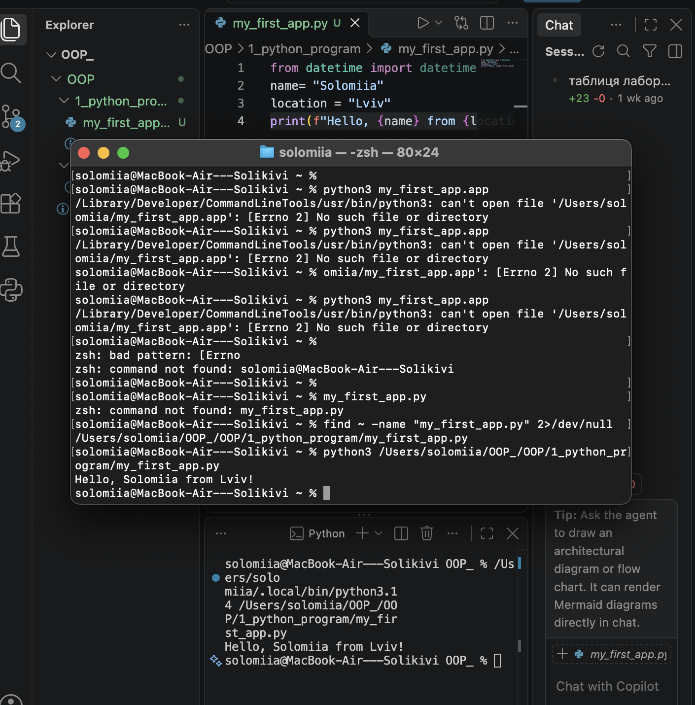
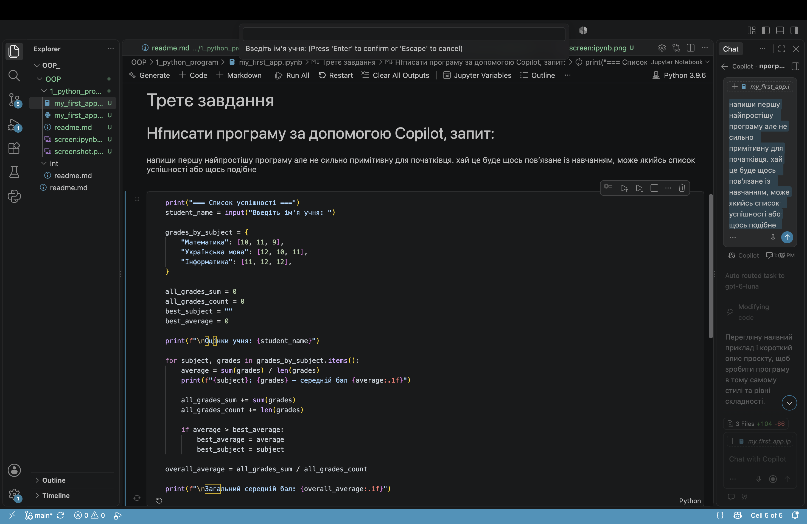

# Звіт до лабораторної роботи
**Тема:** Вступні заняття: налаштування середовища початок роботи з Python та Markdown. 
**Мета роботи:** Налаштувати середовище роботи у VS Code, створити репозиторій GitHub та налаштувати інтеграцію з ним, написати першу програму на Python і створити звіт із використанням форматування Markdown.

## Виконання роботи

### Завдання 1. Налаштування середовища

У VS Code було встановлено та перевірено розширення Python, Jupyter і GitHub Copilot. Було підготовлено робочу папку для лабораторної роботи.

### Завдання 2. Перша програма на Python

Було створено файл `my_first_app.py`. Програма використовує змінні для збереження імені та назви міста, отримує поточні дату й час та виводить повідомлення в консоль.

```python
from datetime import datetime

name = "Solomiia"
location = "Lviv"

print(f"{name} starts programming at {datetime.now()}. {location} is the best city!")
```

Результат виконання програми:



### Завдання 3. Виконання програми в Jupyter Notebook

Було створено файл `my_first_app.ipynb`. У першій комірці виконано програму на Python, а в іншій комірці створено текст із використанням Markdown.

Результат виконання програми:


### Завдання 4. Використання Markdown

У Notebook було створено комірку Markdown із заголовком та описом програми. Після виконання комірки текст відобразився у форматованому вигляді.

### Завдання 5. Використання AI / Copilot

За допомогою GitHub Copilot було отримано приклад простої програми на Python та пояснення її роботи.

**Відповідь AI:** 



## Результати виконання

- Створено програму на Python.
- Виконано програму у файлі `.py` та в Jupyter Notebook.
- Використано форматування Markdown.
- Перевірено приклад коду, запропонований AI.
- Підготовлено файли лабораторної роботи для завантаження в GitHub.

## Висновок

Під час лабораторної роботи я навчилася працювати з Python у VS Code, створювати та запускати програми, використовувати Jupyter Notebook і форматувати текст за допомогою Markdown. Також я ознайомилася з використанням GitHub Copilot та перевірила запропонований ним код.

Мети роботи досягнуто. Основні завдання виконано. Відповіді на запитання було отримано під час виконання роботи. Якщо виникали труднощі, їх вдалося вирішити.

Формат виконання роботи є зручним, оскільки дає змогу зберігати код, результати та пояснення в одному репозиторії.

**Feedback:** Формат здачі роботи мені подобається, оскільки можна побачити результат виконання програми та зберегти історію змін.

**Suggestions:** Було б корисно додавати більше прикладів оформлення звітів і пояснень щодо роботи саме з GitHub. 

